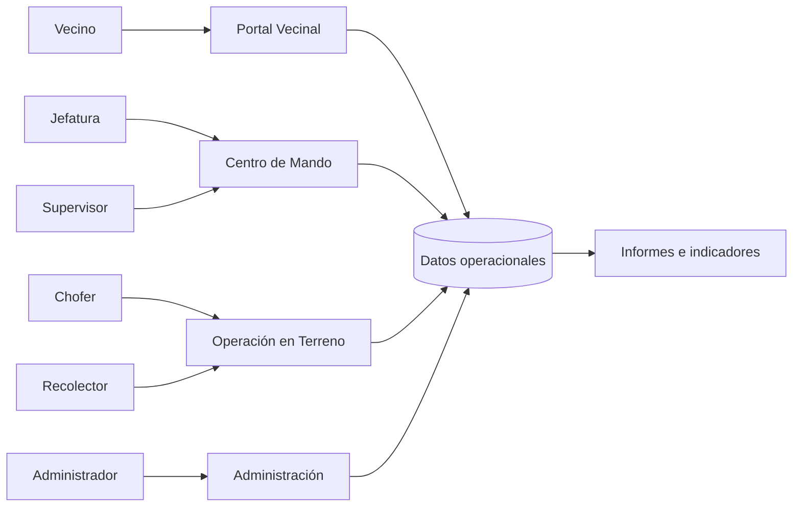

# 🌱 GestiónVerde

> **Proyecto desarrollado en 2026 como propuesta para la Municipalidad de Puerto Montt**, orientado a digitalizar, ordenar y dar trazabilidad a operaciones de reciclaje y recolección mediante planificación, trabajo en terreno, seguimiento e informes.

**Autor:** Alex Osorio  
**Contexto:** propuesta de proyecto para la Municipalidad de Puerto Montt · 2026  
**Tipo:** caso de estudio / prototipo de portafolio  
**Demo pública:** [gestionverde-90fa1.web.app](https://gestionverde-90fa1.web.app)  
**Código fuente:** no incluido en esta publicación pública

---

## 🖥️ Vista del sistema

  <strong>👆 Haz clic en la imagen para abrir GestiónVerde</strong>

> La imagen superior se genera automáticamente desde la versión pública desplegada del proyecto, por lo que puede actualizarse cuando cambie la interfaz.

---

## 🎯 El problema

Una operación de recolección puede depender de registros manuales, coordinación dispersa y poca visibilidad sobre lo que ocurre durante una jornada. Eso dificulta responder preguntas simples pero importantes:

- ¿Qué viviendas estaban programadas?
- ¿Cuáles fueron atendidas?
- ¿Dónde hubo ausencia o incidencia?
- ¿Cómo avanza la ruta?
- ¿Qué ocurrió durante la jornada?
- ¿Qué indicadores quedan disponibles al cierre?

## 💡 La propuesta

**GestiónVerde** centraliza el flujo operacional y separa responsabilidades mediante roles y permisos.

`Planificación → Asignación → Recorrido → Registro en terreno → Seguimiento → Cierre → Informe`

La idea es convertir el trabajo diario en información estructurada que pueda utilizarse para coordinación, supervisión y toma de decisiones.

---

## 🧭 Arquitectura funcional

### Áreas principales

| Área | Objetivo |
|---|---|
| **Portal Vecinal** | Información, solicitudes, avisos e historial autorizado |
| **Centro de Mando** | Jornadas, rutas, usuarios, seguimiento e indicadores |
| **Operación en Terreno** | Navegación, GPS, viviendas, retiros e incidencias |
| **Administración** | Roles, permisos, configuración y auditoría |
| **Informes** | Consolidación de resultados para seguimiento y análisis |

---

## 👥 Actores del sistema

| Actor | Responsabilidad principal |
|---|---|
| **Administrador** | Configuración, usuarios, permisos y auditoría |
| **Jefatura** | Planificación de jornadas, rutas, equipo e informes |
| **Supervisor** | Seguimiento del avance e incidencias |
| **Chofer** | Consulta de ruta, navegación y posición operacional |
| **Recolector** | Registro de retiros, ausencias, observaciones e incidencias |
| **Vecino** | Solicitudes, avisos e historial autorizado |

---

## ✨ Funcionalidades consideradas

- Gestión de jornadas de recolección.
- Administración de rutas y sectores.
- Registro de viviendas y puntos de atención.
- Seguimiento de recorrido y avance operacional.
- Uso de GPS y mapas.
- Registro de retiro, ausencia e incidencia.
- Portal vecinal y comunicaciones.
- Indicadores e informes por jornada, sector y periodo.
- Control de acceso según rol.
- Consideración de conectividad intermitente y sincronización posterior.

---

## 🧾 Ejemplo de requisito

**RF-07 — Registrar resultado de una vivienda**

**Historia de usuario:**  
Como **recolector**, quiero registrar si una vivienda realizó entrega, estuvo ausente o presentó una incidencia, para que la jornada quede correctamente registrada.

**Criterios de aceptación:**

1. El usuario debe estar autenticado.
2. Solo puede registrar viviendas pertenecientes a su jornada asignada.
3. Debe poder seleccionar `Realizada`, `Sin retiro` o `Incidencia`.
4. El sistema registra fecha y hora del evento.
5. El registro queda asociado a la jornada correspondiente.
6. Si no existe conexión, el evento puede quedar pendiente de sincronización.

**Datos sensibles involucrados:** dirección, coordenadas, observaciones y cualquier dato asociado a una vivienda o persona.

---

## 🔐 Privacidad y seguridad

El diseño considera el principio de **mínimo dato necesario** y separación de permisos según rol.

No deberían exponerse públicamente:

- nombres completos de vecinos;
- teléfonos o correos personales;
- direcciones particulares;
- coordenadas privadas;
- historial individual de atención;
- identificadores internos de usuario;
- información operacional restringida.

Las vistas públicas deberían utilizar información agregada siempre que sea posible.

---

## 📊 Indicadores propuestos

- viviendas programadas;
- viviendas atendidas;
- ausencias;
- incidencias;
- porcentaje de avance;
- duración de la jornada;
- kilómetros recorridos;
- material o kilos retirados cuando corresponda;
- resultados por sector y periodo.

> Estos indicadores corresponden al diseño del sistema y no se presentan como resultados reales de una implementación municipal.

---

## 🧠 Mi trabajo en el proyecto

En GestiónVerde he trabajado en:

- análisis del problema;
- levantamiento y organización de requisitos;
- definición de actores y permisos;
- historias de usuario y criterios de aceptación;
- identificación de datos sensibles;
- diseño de flujos operacionales;
- arquitectura funcional;
- experiencia de usuario;
- definición de indicadores e informes;
- consideraciones de seguridad y privacidad.

---

## 🚀 Estado del proyecto

**Fase actual:** prototipo / propuesta de piloto con versión web demostrable, desarrollada en 2026 para un contexto municipal en Puerto Montt.

### 🌐 Probar GestiónVerde

👉 **[Abrir la demo pública](https://gestionverde-90fa1.web.app)**

El objetivo de un piloto sería validar si la solución mejora:

- trazabilidad;
- coordinación;
- seguimiento de rutas;
- calidad de la información;
- generación de reportes;
- comunicación con usuarios.

### Próximos pasos

- pruebas con escenarios reales de operación;
- validación de permisos por rol;
- pruebas de conectividad intermitente;
- medición de indicadores del piloto;
- ampliar la galería visual con vistas representativas sin datos sensibles.

---

## 📚 Documentación

- [Arquitectura y flujo](./docs/ARQUITECTURA.md)
- [Requisitos e historias de usuario](./docs/REQUISITOS.md)
- [Privacidad y seguridad](./docs/SEGURIDAD.md)

---

## 👨‍💻 Autor

**Alex Osorio**  
Estudiante del área informática · Chile  
2026

> **Aviso:** GestiónVerde fue desarrollado en 2026 como propuesta para la Municipalidad de Puerto Montt y se publica aquí como proyecto de portafolio. Esta publicación no representa una plataforma oficial ni una comunicación institucional de la Municipalidad.