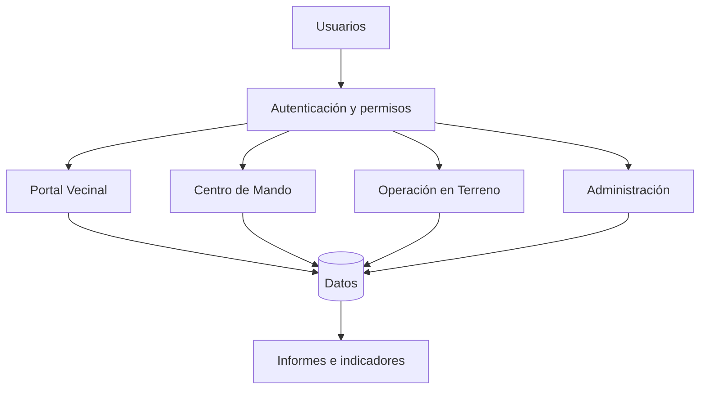
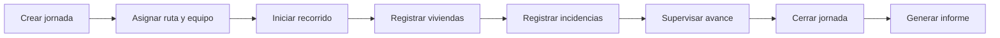

# Arquitectura y flujo de GestiónVerde

## Objetivo

La arquitectura funcional separa el sistema en áreas según responsabilidad, evitando que todos los usuarios tengan acceso a toda la información.

## Componentes principales

## Flujo de una jornada

## Separación por rol

- **Administrador:** configuración, permisos y auditoría.
- **Jefatura:** planificación y gestión operacional.
- **Supervisor:** seguimiento y revisión de incidencias.
- **Chofer:** ruta y navegación.
- **Recolector:** registro de resultados en terreno.
- **Vecino:** información, solicitudes e historial propio autorizado.

## Principios de diseño

1. Mínimo privilegio.
2. Mínimo dato necesario.
3. Separación entre información pública y privada.
4. Trazabilidad de eventos importantes.
5. Operación tolerante a conectividad intermitente.
6. Datos estructurados para generar indicadores e informes.

> Documento de arquitectura conceptual para portafolio. No describe infraestructura productiva de una institución real.